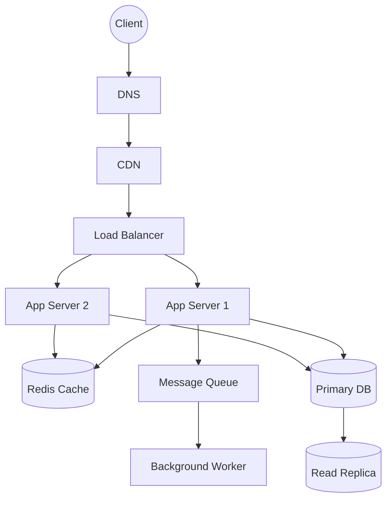

# QuickNotes Architecture

## Requirements
* **Functional:** CRUD operations for notes, user authentication, tagging system.
* **Non-Functional:** High availability (99.9%), sub-200ms response times, secure data transmission (HTTPS).

## Load Estimates (1 Million Users)
* **Reads:** ~25 RPS average, peaking at 100 RPS.
* **Writes:** ~5 WPS average, peaking at 20 WPS.
* **Storage:** ~100GB per year (assuming 1KB per note + index overhead).

## Architecture Diagram

## Component Explanations

- **Client**: Web/Mobile interface making HTTP requests.
**DNS:** Routes domain names to the nearest CDN edge node.
**CDN:** Caches static assets to reduce server load and latency globally.
**Load Balancer:** Distributes traffic across stateless App Servers to prevent bottlenecks.
**App Servers:** Execute API logic and handle validation.
**Cache:** Stores frequent reads (like hot notes) to protect the database from traffic spikes.
**Primary DB:** Handles all writes and maintains the source of truth.
**Read Replica:** Offloads heavy read queries from the primary database.
**Queue & Worker:** Handles background tasks (e.g., search indexing, email alerts) asynchronously so API requests remain fast.

## Request Flows

**GET /notes:** Client -> LB -> App Server -> Cache (miss) -> Read Replica -> App Server -> Cache (store) -> Client.
**POST /notes:** Client -> LB -> App Server -> Primary DB (write) -> Cache (invalidate) -> Queue (push event) -> Client (201 Created).

## Trade-offs and Single Points of Failure
**Trade-off:** Read Replicas introduce eventual consistency delays. Mitigation: Route "read-after-write" requests directly to the Primary DB.
**Trade-off:** Caching adds complexity regarding stale data. Mitigation: Use strict TTLs and event-driven invalidation when writes occur.
**Avoiding SPOFs:** We use multiple stateless App Servers behind a Load Balancer; if one crashes, traffic seamlessly shifts. The database uses a primary/replica setup with automated failover if the primary node dies.